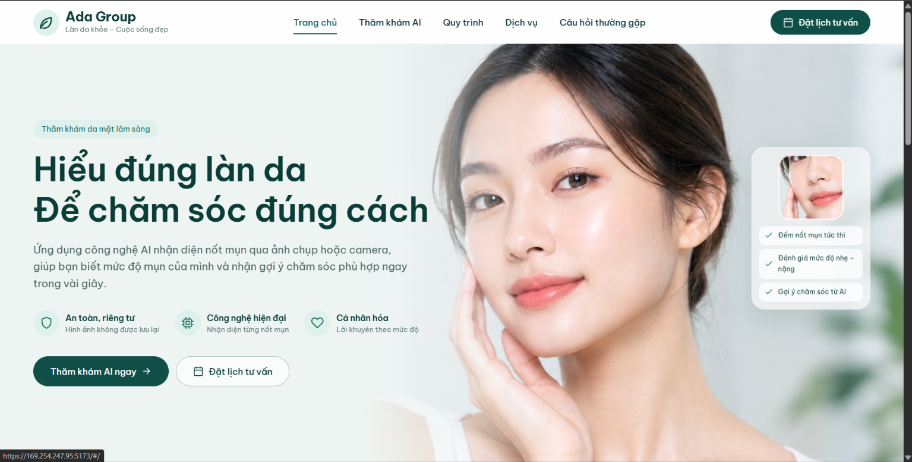
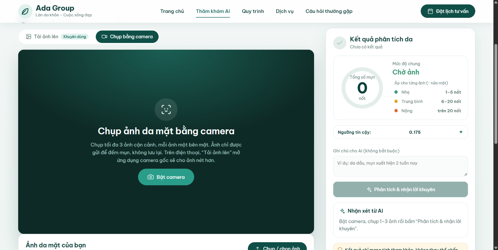

# AcneScope - đánh giá mụn qua camera

Web app đếm mụn qua ảnh, backend FastAPI, frontend React/Vite. Người dùng tải lên hoặc chụp tối đa 3 ảnh cận da mặt, YOLO26m đếm mụn từng ảnh rồi cộng lại. Mức độ xếp theo thang Hayashi rút gọn cho từng ảnh, sau đó AI gợi ý cách chăm sóc.





Cách deploy: [DEPLOY.md](DEPLOY.md). Notebook train và báo cáo: [train/](train/).

## 1. Backend
```bash
cd backend
python -m venv .venv && .venv\Scripts\activate
pip install -r requirements-model.txt    # đủ ultralytics, pillow-heif. requirements.txt chỉ là bản nhẹ để deploy
# torch CUDA cho RTX 3050, phải cài sau vì bước trên kéo torch bản CPU về
pip install --force-reinstall --no-deps torch==2.14.1 torchvision==0.29.2 --index-url https://download.pytorch.org/whl/cu132
# Model: ../model/y26m_1280/weights/best.pt (MODEL_WEIGHTS trong backend/.env)
python test_model.py anh1.jpg anh2.heic anh3.jpg   # test model, ảnh vẽ khung lưu ở backend/test_out/
uvicorn app.main:app --host 0.0.0.0 --port 8000
```
Test nhanh bằng `curl -F file=@anh.jpg http://localhost:8000/api/detect`. Swagger ở http://localhost:8000/docs, còn `GET /api/health` cho biết đang chạy CPU hay CUDA.

## 2. Frontend
```bash
cd frontend
npm install
npm run dev
```
- Trên máy tính mở `https://localhost:5173`.
- Trên điện thoại (cùng Wi-Fi) mở `https://<IP-máy-tính>:5173`, gặp cảnh báo chứng chỉ thì bấm Nâng cao rồi tiếp tục. Trình duyệt chỉ cho mở camera trên HTTPS nên giữ `VITE_HTTPS=true`.
- Nhớ mở cổng 5173 và 8000 trên firewall.

## 3. File môi trường
- `backend/.env`: `MODEL_*` (model), `DEDUP_*` (bỏ khung trùng), `CONF_DEFAULT` (ngưỡng đếm, mặc định 0.175), `SEV_*` (thang mức độ và cách gộp), `LLM_*` (AI lời khuyên). Mẫu ở `backend/.env.example`.
- `frontend/.env`: địa chỉ backend, HTTPS, thương hiệu.

## Mức độ (thang Hayashi rút gọn, áp cho từng ảnh)
| Số nốt / ảnh | Mức |
|---|---|
| 0 | Không phát hiện |
| 1–5 | Nhẹ |
| 6–20 | Trung bình |
| >20 | Nặng |

Mỗi ảnh coi như nửa mặt nên không áp ngưỡng lên tổng. Mức chung lấy theo `SEV_AGGREGATE`: `max` là mức cao nhất trong các ảnh (mặc định), `mean` là xếp theo số mụn trung bình.

## Luồng hoạt động
1. Người dùng tải ảnh lên, trên điện thoại sẽ mở luôn app camera. Hoặc chụp ngay trên trình duyệt: ưu tiên `ImageCapture.takePhoto`, không có thì lấy khung nét nhất trong 6 khung. Tối đa 3 ảnh.
2. FE gửi từng ảnh gốc tới `POST /api/detect`, kể cả HEIC. BE xoay theo EXIF, chạy model ở imgsz 1280, rồi trả mọi khung có conf ≥ `CONF_FLOOR` kèm ảnh xem trước. Ảnh không được lưu lại.
3. FE đếm số khung từ ngưỡng trở lên, cộng tổng và tính mức độ. Kéo thanh trượt thì đếm lại ngay, không phải chạy lại model.
4. Bấm "Phân tích & nhận lời khuyên" sẽ gọi `POST /api/advice {counts:[...]}`. Chưa cấu hình LLM thì dùng lời khuyên có sẵn.

## Giao diện
- Có hai trang là Trang chủ (`#/`) và Thăm khám AI (`#/kham`). Nav cuộn tới Dịch vụ, Quy trình, Câu hỏi thường gặp.
- Ảnh nền hero là `frontend/public/images/hero.jpg`, ảnh thẻ dịch vụ ở `frontend/public/images/services/` (khai báo trong `SERVICES` ở `Home.jsx`). Muốn đổi ảnh thì thay file.
- Logo là `frontend/public/logo.svg`. Tên công ty, slogan, link đặt lịch, hotline, email đặt trong `frontend/.env`.
